# RimQud

Research toward a **high-contrast, Qud-faithful visual overhaul** using selected
RimWorld rendering techniques and locally sourced rendering resources. Qud keeps
its own simulation and controls.

**Art completion reset, 2026-10-20: every entry is unfinished.** Earlier claims
of a completed village conversion were incorrect: loading layers and passing
native tests did not prove the agreed art workflow, fit or visual quality.
The [conversion ledger](docs/conversion-ledger.md) now enumerates every resident,
body, equipped item/fitting, scenery and tile/state target. It requires one
active entry and an evidence-backed process log. Existing assets are historical
inputs, including Tam and Ctesiphus; no completion credit is carried forward.

The [HTML conversion report](docs/conversion-report.html) records the new
generation workflow step by step. Five human body templates are generation-ready:
adult male/female, older male/female, and a shared featureless child base for both
template labels. The child Woven Tunic is also generation-ready as a separate,
source-bound garment with recorded coverage cuts. Native acceptance and the
remaining clothing fits are pending.
Adult and child dromad bases are also generation-ready, with centered directional
body/head layers and separate neutral dulla coverage. Juvenile proportions and
detail-region placement are documented authoring choices, not new native facts.
The child dromad's Woven Tunic is generation-ready as an independent garment;
its report preserves the rejected cuff extraction and corrected coverage masks.
Tam's adult Cloth Robe and enlarged Shillelagh fittings are also generation-ready.
Their body, garment and held-item layers remain separate. The report records the
Shillelagh's exact installed description and actual installed Tribal mod reference.
The DirtPath and shared path-material records now select one source-bound
cobblestone-like surface with native brown tint, independent grass coverage and
eight-neighbor states. The report includes manual, refined, patched and selected
material views plus a static Joppa layout; these are not native game captures.
All three Basic Grass variants are generation-ready as sparse neutral paint,
with their distinct source layouts and common cell frame retained. The report
records Grass 1's first faint registration and direct width/value correction.
The grassy-field substrate now uses Qud's native dark-teal background, while bare
soil adds sparse native-brown grit through separate coverage. Selected shallow
and deep water use separate refined materials in the native blue family, with
independent shoreline and depth-blend coverage. Pond binds those two documented
conversions and preserves separate foreground objects; the native Watervine used
in its composition is context only. These are authoring plates, not game captures.
Brinestalk Wall is generation-ready with 16 fixed-frame connected states, stripped
upright trunk faces, a restrained mud cap and separate native primary/detail
layers. Its installed Architect mod reference, first rejected cap design and
corrected connected assembly are recorded. Native atlas/visibility/occlusion
acceptance remains pending.
The gearbox-wall binding adopts the same selected wall art: installed defaults
add native power transmission, with no distinct ordinary gearbox sprite. DirtFloor
likewise binds the performed packed-earth conversion rather than regenerating it.
Brinestalk Fence is generation-ready with all 16 actual painted source states,
squared salt-tipped pickets and separate native color layers. Its earlier inherited
placeholder is documented, and its refinement/edge-on cap correction is recorded.
BrineBridge is generation-ready with its four actual native cosmetic selectors,
a continuous dried-stalk deck and shared coverage. The report records the rejected
spaced-mat sketch, correction, refinement and liquid-underlay composition. Its
nonbinary native source mask uses a constant 65/255 foreground/detail mix;
neutral art preserves that runtime tint contract rather than baking literal green.
Door is generation-ready with fixed-frame open/closed slate artwork. Its actual
runtime state tiles replace the old blueprint-thumbnail assumption; the surround
is byte-identical between states and the leaf/frame keep separate color roles.
Rusted Metal Wall now preserves native rust-red/pale-cyan colors, source-shaped
industrial bracing and authored welded diamond mesh. All 256 native eight-neighbor
variants and the 16 cardinal layouts are recorded, including the rejected literal
checker trace, material refinement and geometry correction.
Living Brinestalk now has source-positioned fibrous pilings and a separate neutral
growth mask; its neutral view contains no baked green. Dogthorn includes both
actual native RandomTile variants, with independently constructed/refined crowns,
pointed bark splinters and exposed roots. Its neutral foliage/wood layers preserve
native green/brown color roles. The report records the actual installed Vanilla
Textures Expanded references, source metadata, editable inputs and extraction.
Starapple now has a source-shaped sparse crown, exposed ashen-textured branches
and a separate neutral fruit mask. Native harvest states keep identical geometry
while fruit tint changes from ripe red to unripe dark teal. The Ripe sibling uses
the same performed conversion with exact source comparison: only its starting
ripe chance differs. The actual native primary green remains authoritative.
Watervine is generation-ready across all three native layouts and both harvest
tints, with separate neutral vine/wafer layers. Its actual refinement calls,
source-positioned wafer marks, alpha cleanup and native firefly-particle boundary
are recorded. All five vegetation entries are now generation-ready.
The Alchemist Table is also generation-ready: scorched wood, left phial rack and
tall alembic follow its original shape. Neutral glass ownership includes pale
reflections without turning wooden rack edges cyan. Native inventory/empty-full
tag behavior stays explicit in its source packet and report.
There are now 34 generation-ready entries; Argyve Multicabinet is active next.
Other walls, furniture and the remaining entries are unfinished.
Generate every pending entry before running native validation. Reusable race
bodies are unmutated; individual mutation appearance belongs to the separate
framework, with the native metadata retained.

**Current result: donor rendering is connected to Qud's actual gameplay map
camera in a fully generated Joppa game.** Native movement, look targeting, modern
inventory, save/load and three continuous native turns passed isolated automated
checks. Foreground review also verified mouse walking, NPC targeting, zoom,
physical I opening inventory, the full HUD and mouse-driven save/quit. This is
an experimental integration, not a released overhaul.

**Earlier coverage was narrow:** the controlled baseline replaced 10 of 67 selected
blueprint types; 57 types, including NPCs and furniture, retain native sprites.
Repeated ground/path cells account for much of that apparent coverage.
The [staged implementation](docs/joppa-integration-spec.md) has now passed its
layered human/animal/prop scene, native hurt reactions and an explicit Joppa
coverage review and actual equipped-item integration. All four bounded stages
passed; faithful art and broader anatomy support remain separate work.

The [faithful-art specification](docs/faithful-joppa-spec.md) remains ACTIVE;
its art criteria have not passed.
The [installed-source anatomy/clothing study](docs/joppa-bodies-and-mutations.md)
identifies Joppa's four species families and the named humans' defining mutations.
The captured village now has a bounded source-bound conversion; generic anatomy
and third-party item conversion remain outside this sample.

**Historical integration draft: 16 residents across 10 NPC/creature blueprints,
plus 57 selected environment types.** Shared human bodies, fixed Irudad/Nima/Yrame
anatomy, the retained ray cat, glowfish and Tam use actual equipped item layers.
Tam's staff is enlarged. Scenery follows original Qud shapes and palette roles,
with basic grass, connected surfaces and distinct water-depth textures.

[Village gallery and native before/after slider](art/village/preview.html) ·
[Native verification](evidence/village-result.json) ·
[Coverage and reproduction](docs/village-conversion.md).

These unchanged native game-camera frames use original resident positions and
controlled full-map visibility. The player keeps native graphics.

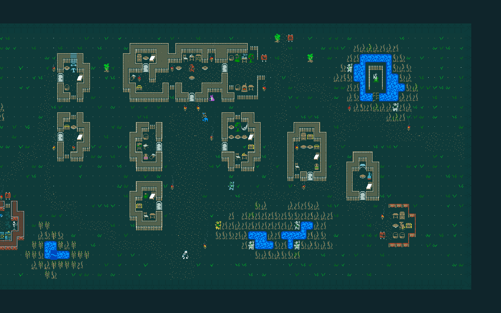

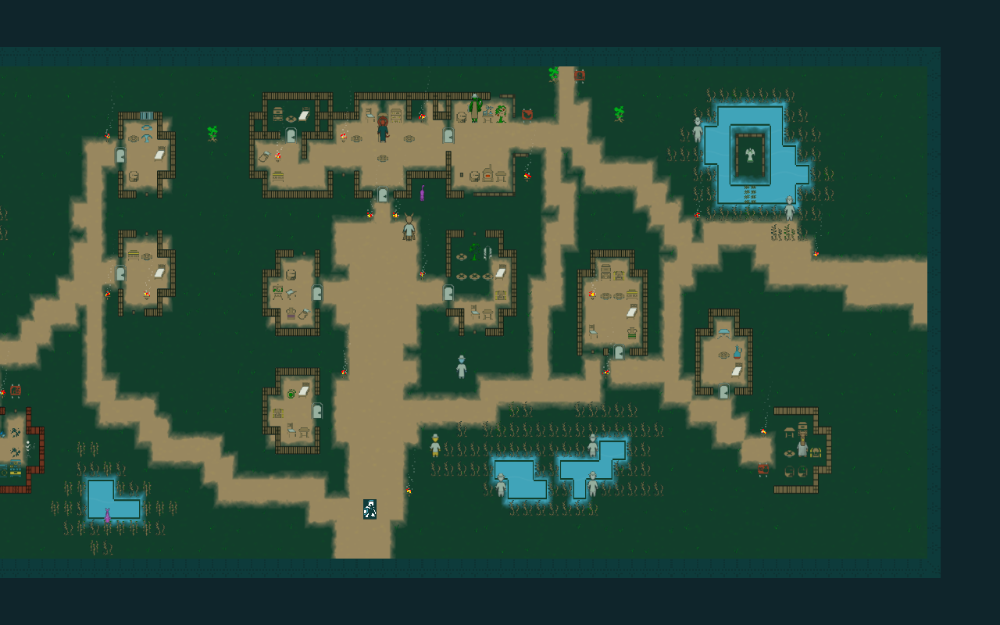

The hidden batch verified all residents, four-way facing, contact/scale,
equipment colors, actual clothing removal/restoration, visibility/fallback,
look, hurt without simulation advance and save/load. Normal saves/settings were
preserved. Fully clothed child templates are authoring variants only: native
actors expose no established age selector, so ages are not guessed.

This is unfinished artwork, not completion of the conversion procedure. Most
scenery remains traced/enlarged glyph contours. Yrame's garment/horn fit and
Glowfish's baked colors are known defects in the ledger. Personal cosmetics, arbitrary mutations and full
donor pawn-tree integration remain outside this result.

The Tam material below records the earlier individual workflow checkpoint.

The selected **adult dromad base for Tam** now has a constructed front, proposed
side/back views and a reviewed composite refinement. It is unclothed so later
garments can be fitted and extracted one item at a time. The long neck, muzzle,
dulla and upper-back hump reflect Qud's description; unseen surfaces are an
authored interpretation. The user's clothed refinement image was not used.

[Labeled unclothed model review](art/dromad/nude/preview.html) /
[input, prompts and selection record](art/dromad/nude/refinement.json).

The reusable [Qud creature-conversion procedure](skills/qud-creature-conversion/SKILL.md)
documents identity/race resolution, body metadata, front-guided turnarounds,
correction/refinement, layer registration and one-item-at-a-time clothing. It is
maintained as a skill source in this repository; no global skill was installed.
Mutation metadata is retained; mutation-specific rendering is postponed.

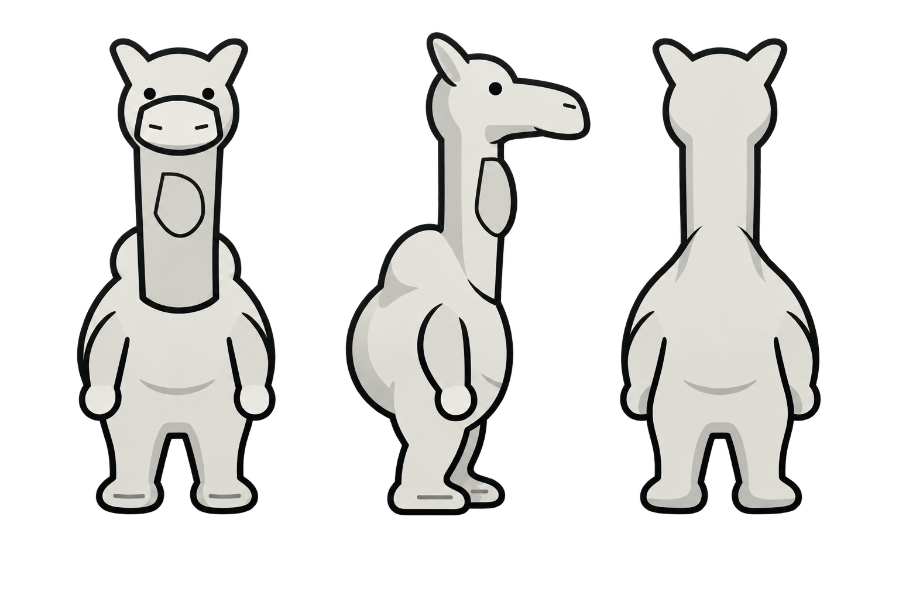

The selected base is now registered and split into body, head/neck and dulla
tint layers. Its actual **Cloth Robe** was refined separately in context and
fitted with explicit coverage masks, leaving the original hands visible.
The Shillelagh is a separate right-hand item. The
[layer inspector and native comparison](art/dromad/layered/preview.html) shows
four directions, layer toggles and Qud palette roles.

The unchanged native frames below show this refined assembly and its matching
original. [Focused native evidence](evidence/dromad-refined-result.json) covers
facing/contact, actual equip/unequip, tint, hurt, look and save/load. The full
village batch above is separate evidence; this earlier checkpoint covers one
adult body and two supported items.
The [earlier vector-only diagnostic](art/dromad/rebuilt/preview.html) remains
separately labeled and pinned to its tested source.

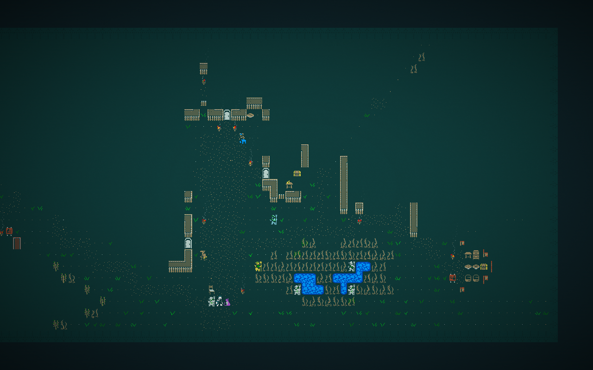

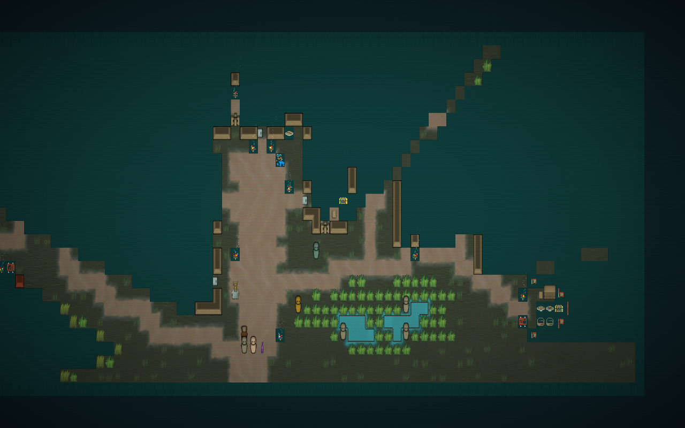

The first faithful tile, **Ctesiphus**, now runs in native Qud. Its frozen input
chain is **creature → race → native race description + actual RimWorld asset
reference + original Qud model**. Generated pixels are unchanged; native material
tint supplies Qud magenta. Direction, physical proportions, feet contact,
visibility, hurt, targeting and save/load passed hidden native checks.
An extra-foot change after observation and changed detail color fall back to the
native sprite. The neutral base has no independent detail mask. This remains a
Qud-side adapter; it does not execute RimWorld's complete pawn render tree.

[Directional art and magnified native captures](art/ctesiphus/preview.html#native) /
[verification and frozen input packet](evidence/faithful-cat-result.json) /
[brief](art/ctesiphus/brief.json) /
[exact generation prompts](art/ctesiphus/generation-prompts.json).

The matched native frames below show original rendering and the current adapter.
Ctesiphus is the small purple cat near the lower-left actor fixture; other
replacement graphics remain temporary or retain native Qud art.

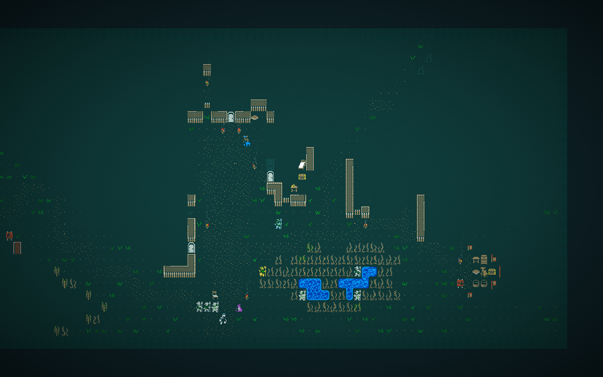

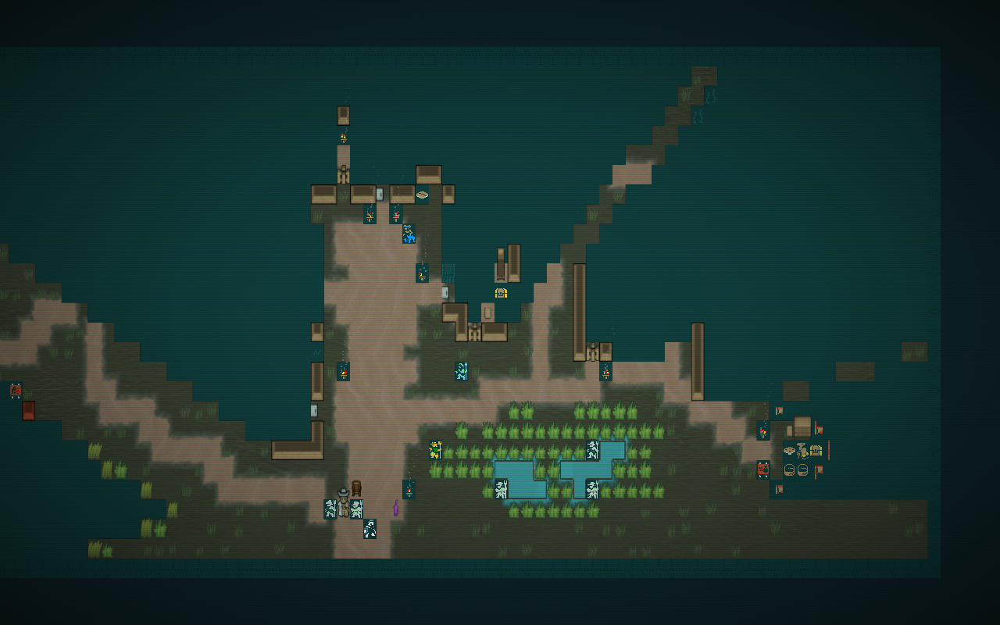

## Actually worn equipment — stage 4

A native farmer fixture now wears items from its actual Qud body slots. The

before frame shows items carried but unequipped; the after frame shows the

same donor body wearing a tunic, cloak, hat and sword. Both are native engine

frames, not original-versus-overhaul art concepts. The actor is beside the chair

near the lower-left edge of the visible region. The [interactive comparison](comparison.html)

opens an 8x browser crop; full images remain unchanged.

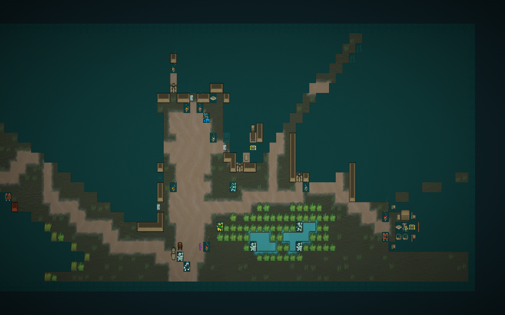

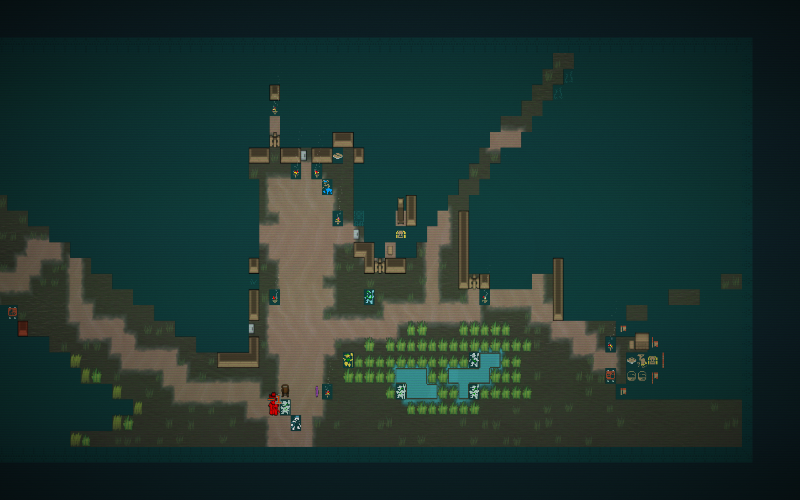

[Supported items and limits](docs/equipped-items.md) and [native evidence](evidence/pawns-stage4-result.json)

cover equip/remove/swap, four directions, item tint, late-change fallback, real

hurt feedback and save/load. Unsupported gear or anatomy restores the native

actor. The current donor Male body is one art template, not comprehensive race,

sex, age or mutation support. Existing residents' equipment was unchanged.

## Joppa coverage — stage 3

All 67 selected baseline types now have reviewed decisions: **26 use temporary
replacements; 41 retain native graphics.** The expanded set includes appropriate
human placeholders, common furniture, wood/metal walls, fences and a bridge.
Distinctive anatomy, machinery and unmatched props retain their Qud designs.
[The complete review](docs/joppa-coverage.md) records each decision and its reason.

These actual 1920 × 900 authored-map GPU captures use the controlled dirt-floor
fill. They show the complete sample, including native fallback; they are not
generated-game field-of-view captures or a finished faithful tileset.

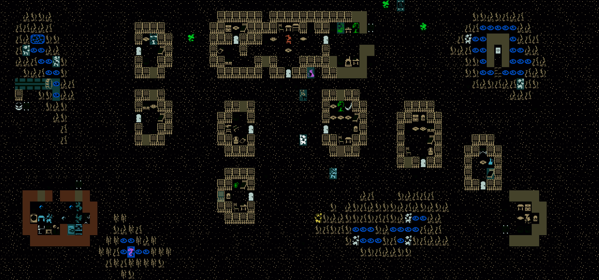

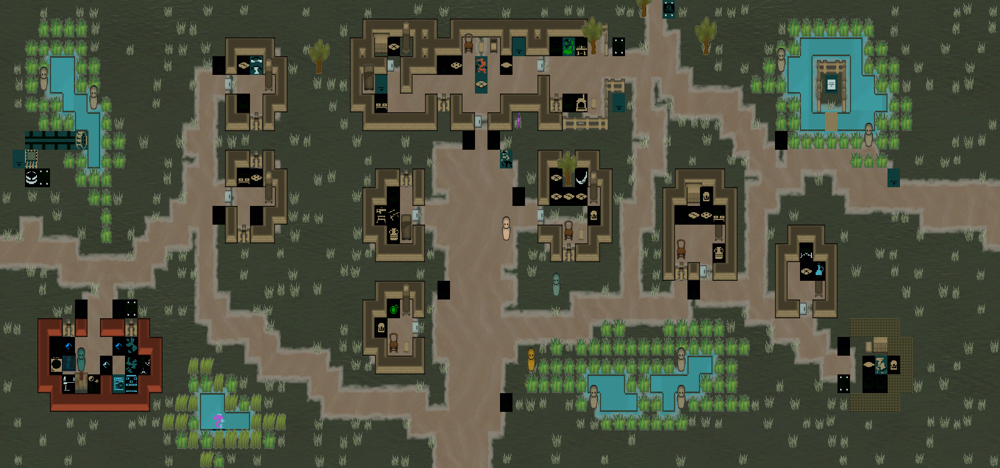

The same mappings also passed the native generated-game workflow. These actual
1280 × 800 map-camera captures preserve native visibility and camera effects;
the diagnostic relocates the existing farmer, cat and chair. Separate HUD omitted.

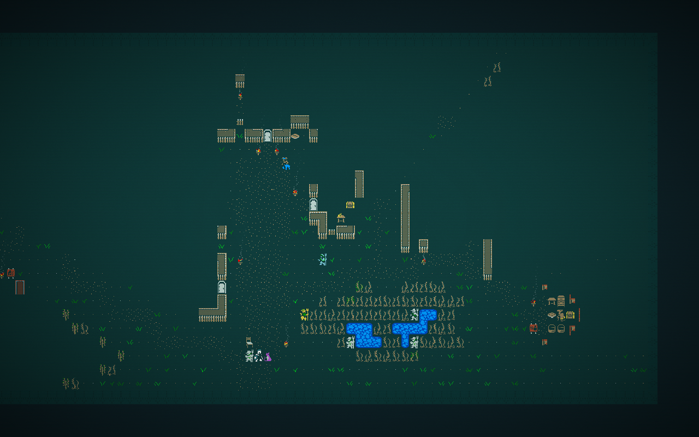

[Stage 3 evidence](evidence/joppa-stage3-result.json) covers prop directions,
door open/close, linked scenery, unsupported flip/native fallback, water depth,
movement/facing, actual hurt reactions, targeting, menus and save/load.

## Layered NPC/prop integration — stage 1

Actual 1280 × 800 native map-camera captures from generated Joppa. The isolated
fixture relocates an existing farmer, Ctesiphus and chair near the player. Humans
use separate donor body/head layers; the cat uses directional donor graphics.
Known native ground stays beneath them, and mapped foregrounds sort by contact
row. Qud's colors, camera effects and original fallback remain. Separate HUD
canvases are omitted from these readbacks.

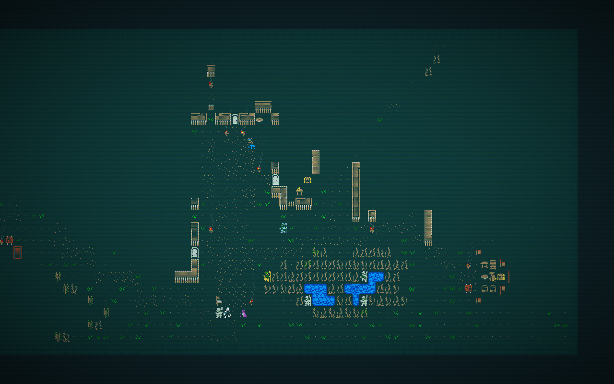

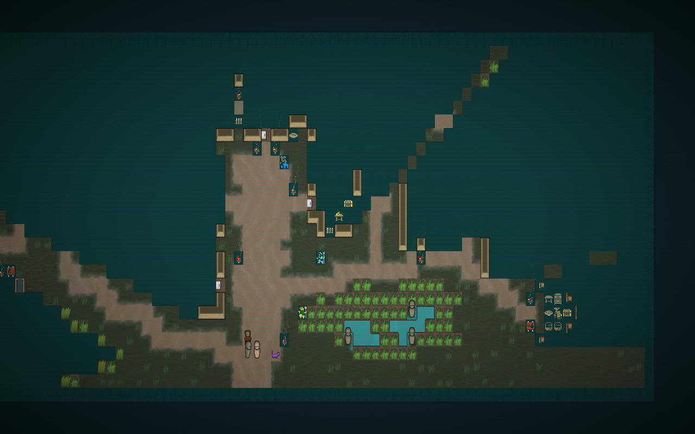

[Stage 1 verification](evidence/pawns-stage1-result.json) covers direction, tint,
visibility, late changes, overlap and native targeting/save-load behavior.
These are temporary NPC graphics, not a faithful completed tileset. No hurt or
apparel animation is claimed by this stage.

## Native hurt reactions — stage 2

Actual Qud damage now drives a short red flash and decaying impact offset on the
temporary humans and animals. Each diagnostic actor loses one native HP through
environmental damage; the reaction completes while Qud waits for input, with no
game tick advancement. These are unaltered native camera captures, not concept art.
The human is beside the chair near the lower-left edge of the visible area.

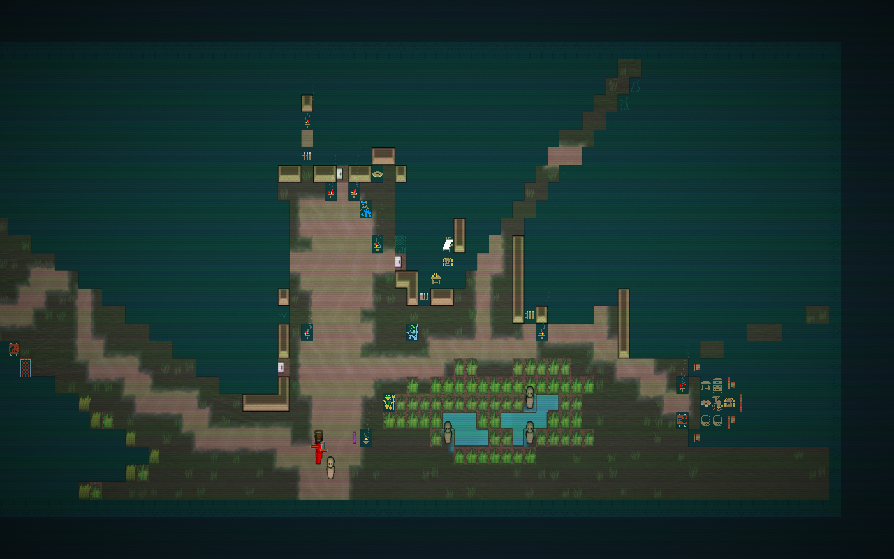

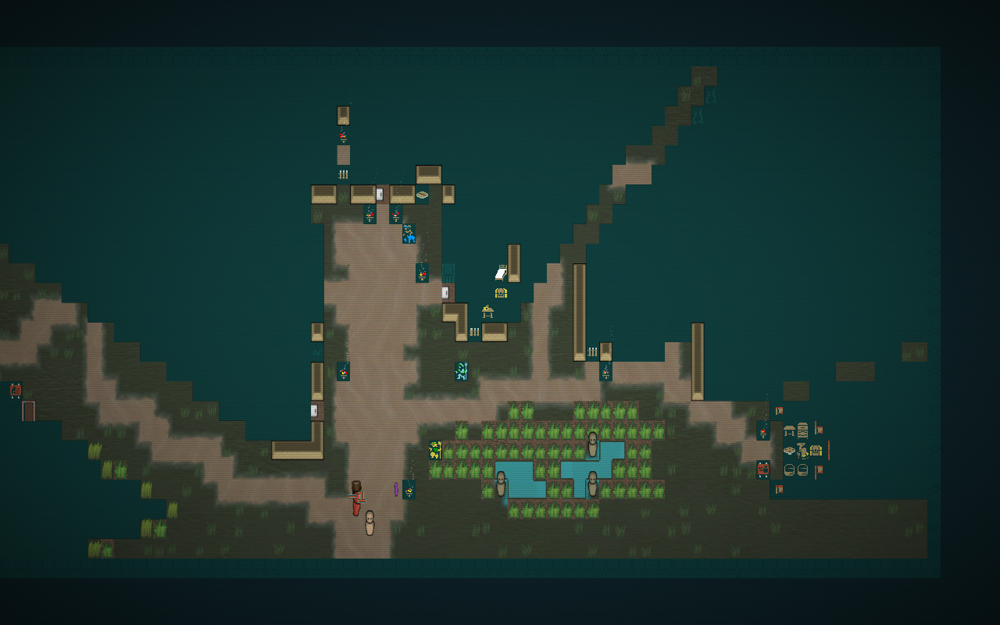

Ctesiphus uses the same event/lifetime path with his native purple tint:

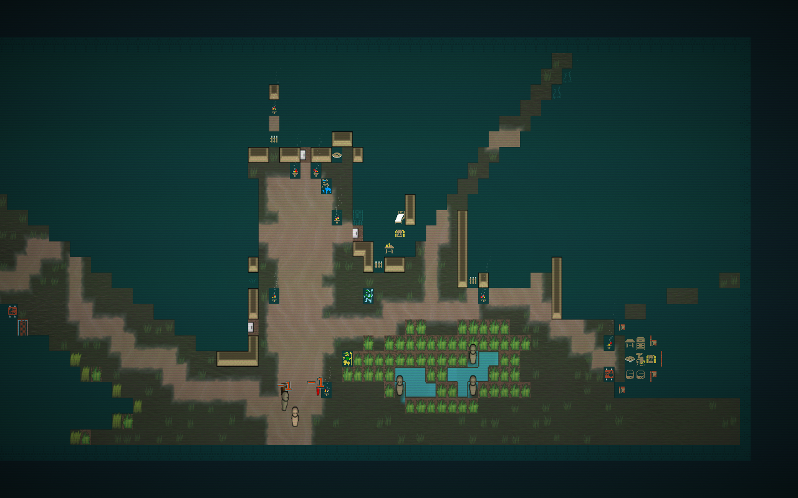

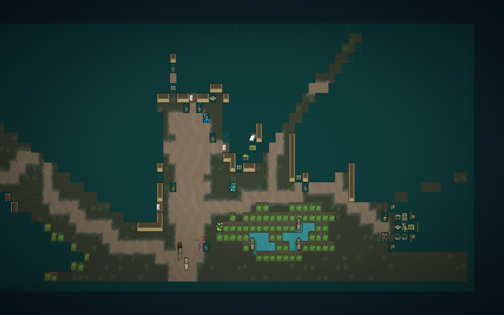

[Stage 2 verification](evidence/pawns-stage2-result.json) also checks native
movement/facing, targeting, inventory, menu return, disabling, save/load and three
native turns. Donor downed/dead behavior and visible equipment are not claimed.

## Foreground review

Unaltered captures of the actual 1280 × 800 game window, including its native HUD:

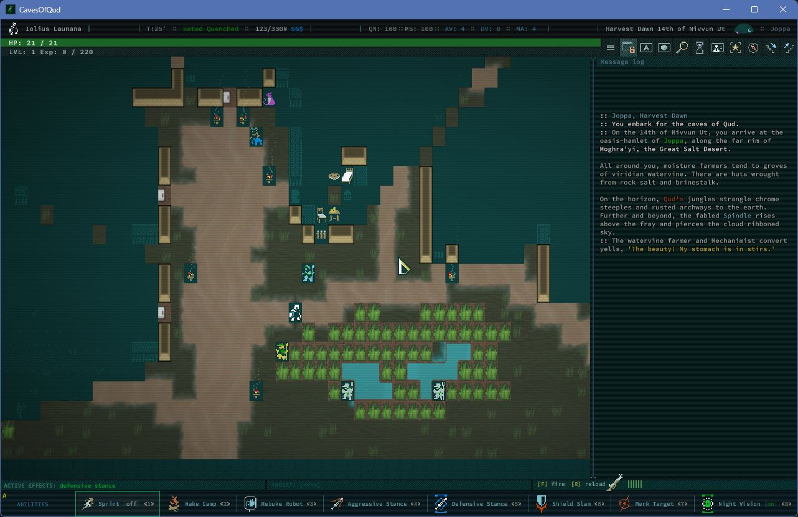

Opening a native menu deliberately restores Qud's original presentation; the
donor layer returns when gameplay resumes. This conservative fallback also
applies to inventory and NPC context menus.

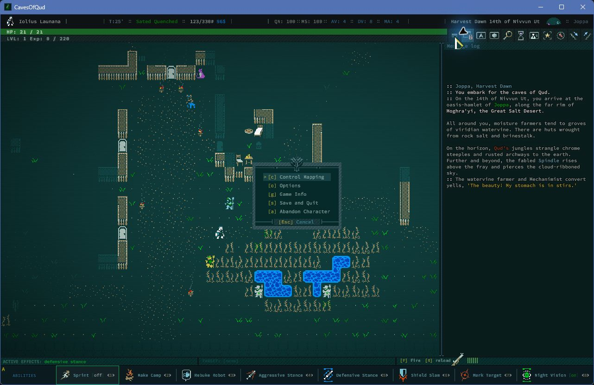

[Foreground evidence](evidence/foreground-review.json) distinguishes direct
observations from user-confirmed physical input. Keyboard movement and the
Escape menu shortcut remain unverified: Escape stopped the remote-control tool.
Synthetic shortcuts did not activate native commands, although physical I did.
Long-session stability and FPS have not been established.

## Actual gameplay-view integration

These unaltered 640 × 480 readbacks use Qud's own map camera after a native save/load
round trip, including native field of view and camera effects. They omit separate
HUD canvases. The donor layer shares the native tile coordinates; existing input
objects and unmapped native sprites remain in place. Qud's painted bare ground
is mapped directly without adding floor objects to the generated world.

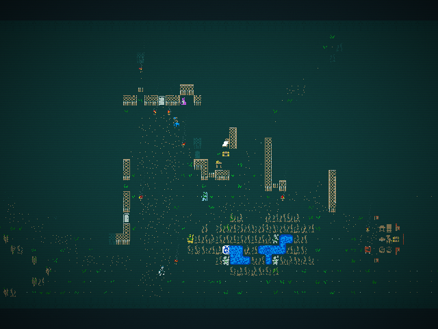

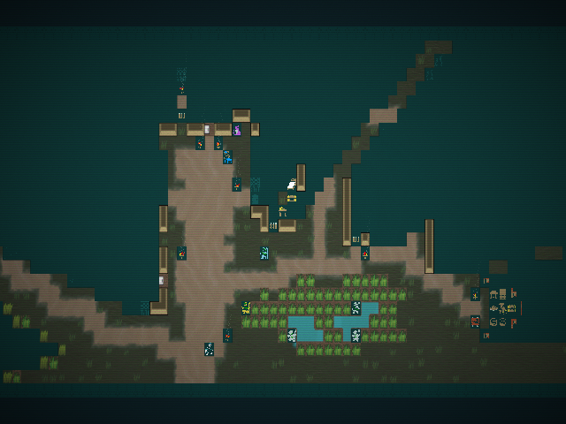

The donor layer clears for look/inventory views, disabling and unmatched buffers.
Native renderer suppression is applied before the map camera draws, after Qud's
own sprite updates. Save/load rebuilds from the newly accepted native frame.
[Verified gameplay evidence](evidence/gameplay-result.json) records the bounded
automated checks; the separate foreground evidence above covers basic controls.

## Full native-map Joppa experiment

These are actual 1920 × 900 GPU captures from the same accepted Qud frame.
The first uses Qud's resolved sprites. The second maps 1,810 cells to donor
materials and retains original sprites for 190 unmapped cells, including NPCs
and furniture. Ground, paths, grass, crops, reeds, trees, water, doors and 161
brinestalk wall cells use donor materials; walls use linked atlas selection.
The current capture includes 274 grass clumps at native ground-paint locations
and 51 connected shallow-water cells.

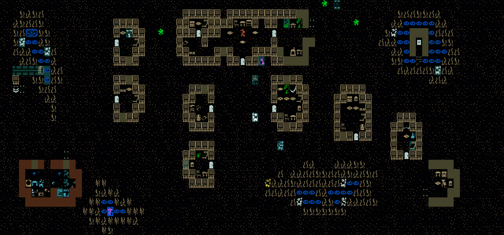

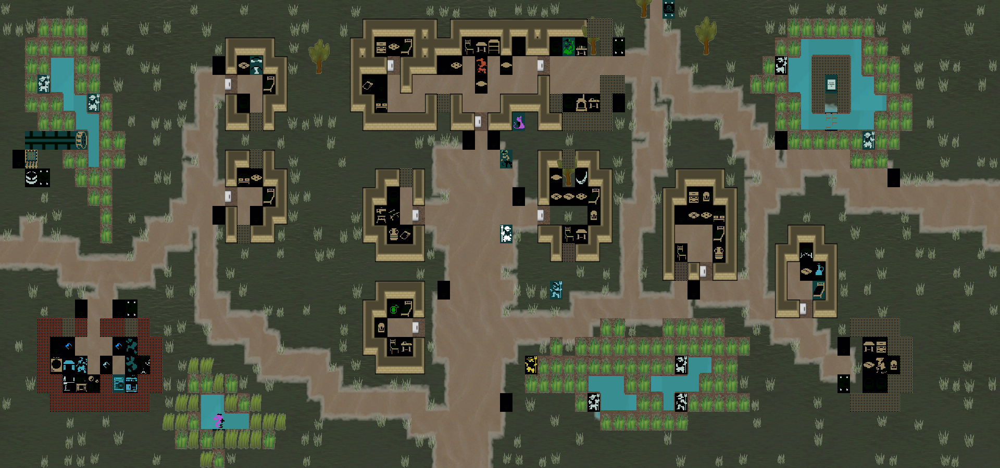

[Local draggable comparison](comparison.html) — download/serve this repository
to use it; GitHub displays HTML source. [Experiment and acceptance](docs/joppa-experiment.md)
and [verified result summary](evidence/joppa-result.json).

Qud's map builder created the 996 authored placements from `Joppa.rpm` over an
explicit dirt-floor fill. This is not normal seeded-world generation; shrine
initialization logged missing world-history data. The renderer preserves native
fallback sprites, including their visible dark tile backgrounds.

Eleven accepted/consumed frames tested liquid depth changes, actor relocation, visibility changes, late
mutation, replacement disabling, view gating, another zone and return. Offscreen
captures include scene creation and PNG readback; their timings are not gameplay
frame times. The later gameplay checks above use a separately generated world.

The path interior and its transition use the same donor fade-rough material,
precedence and texture sampling. The initial hard-interior/rough-edge mismatch
caused the visible bright rim and was corrected. Open water uses Qud's wading
and swimming thresholds with distinct donor ramp textures; this is a connected
liquid adapter, not the complete RimWorld animated water pipeline.

## Earlier isolated shader experiment

These are all eleven original, unaltered **128 × 128 GPU readbacks** from the
executed shader probe. An offscreen camera inside Qud rendered a simple plane
using a locally extracted RimWorld shader and test texture. These images were
not AI-generated. They show material compatibility and input effects; they are
not screenshots of a replacement scene in Qud's gameplay view.

| Shader / input change | Baseline | Changed input | Pixels changed |
| --- | --- | --- | ---: |
| Terrain hard: material tint |  | 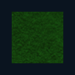 | 7,744 |
| Terrain fade: vertex alpha |  | 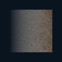 | 7,740 |
| Terrain fade rough: vertex alpha with alpha-add texture | 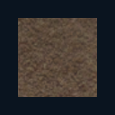 | 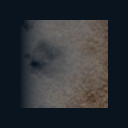 | 7,534 |
| Plant cutout: sway input | 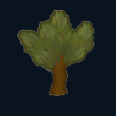 | 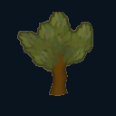 | 3,463 |
| Plant transparent: sway input | 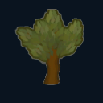 | 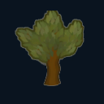 | 3,746 |

The sixth shader, `Custom/Cutout`, was tested with one wall-atlas sample:

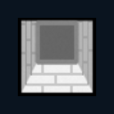

The wall sample establishes that the cutout material draws. It does not establish
connected wall geometry, correct wall-neighbor selection or a finished wall style.
Likewise, the plant pairs compare two sway values; they do not demonstrate a
complete animated vegetation system.

All six shaders reported supported with one pass and produced pixels without
magenta error pixels in Qud's Unity 6000.0.77f1 built-in pipeline on Direct3D11.
The retained [render measurements](evidence/shader-renders.json) and
[result summary](evidence/integration-result.json) record these tests.

## Separate scene-capture experiment

A second launch used real Qud ground, wall, vegetation, actor and liquid objects
in a controlled temporary zone. It tested hidden-object exclusion, actor movement
and a late buffer mutation. Three frame generations matched between the producer
and Unity consumer under the existing buffer lock.

That fixture ran during MainMenu startup with Qud's original presentation.
Its output was diagnostic data, not a donor-shader image of the fixture. It does
not yet prove gameplay view/input integration or a generic layered scene.

The later full-map experiment above connects these two pieces in a controlled
simulation. The later native-game experiment connects it to the map camera;
broader mod compatibility remains unverified. These fixtures remain for provenance.

## Earlier HTML concepts

The previous AI-generated art sheets and before/after browser mockups are
preserved in [the archived HTML visual study](docs/html-visual-study.md).
They illustrate possible art directions and are unrelated to the shader test's
rendered output shown above.

## Findings and source

- [Four extraction/integration audits](docs/audits.md)
- [Verified integration progress and limits](docs/integration-progress.md)
- [Reproduce the isolated experiments](docs/reproducing.md)
- [Bounded next steps and release conditions](docs/roadmap.md)
- [Probe source](probe/) and [retained evidence](evidence/)
- [Image provenance](docs/images/provenance.json) and [third-party notices](THIRD_PARTY.md)

No game assemblies, extracted texture atlases or shader bundles are distributed.
Reproduction requires your own matching local installations. The source is pinned
to the inspected builds and is a diagnostic, not a normal-profile mod installer.

RimQud is independent and unaffiliated with Freehold Games, Ludeon Studios or
Ink Stains Games. Original glue code and documentation are under the
[MIT license](LICENSE); that license does not cover third-party game content
visible in documentation screenshots/readbacks.
