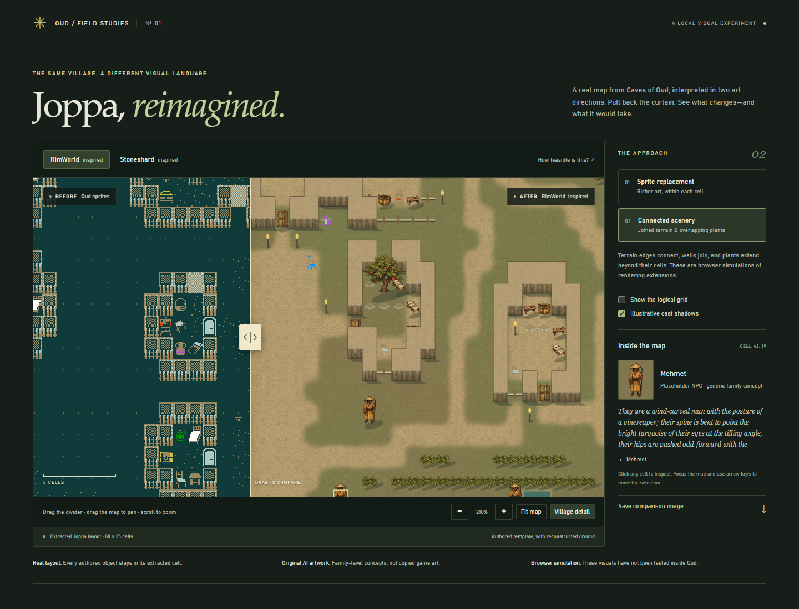
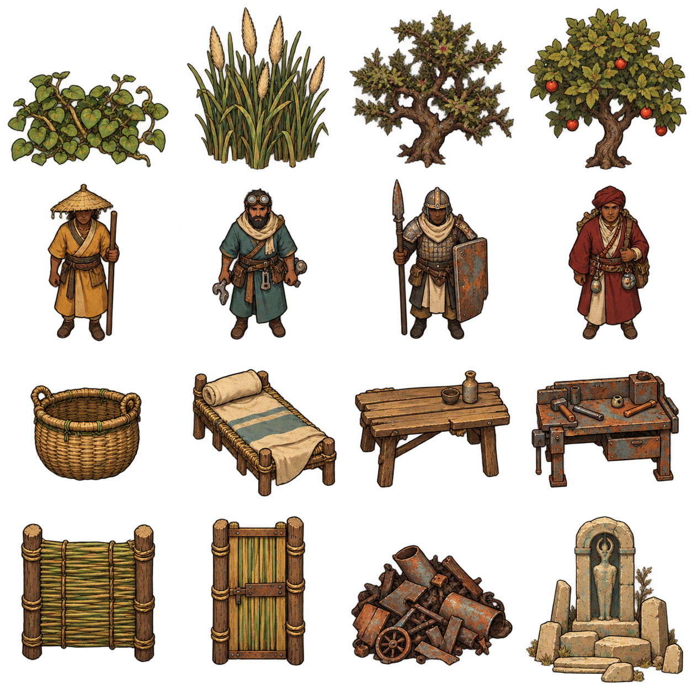
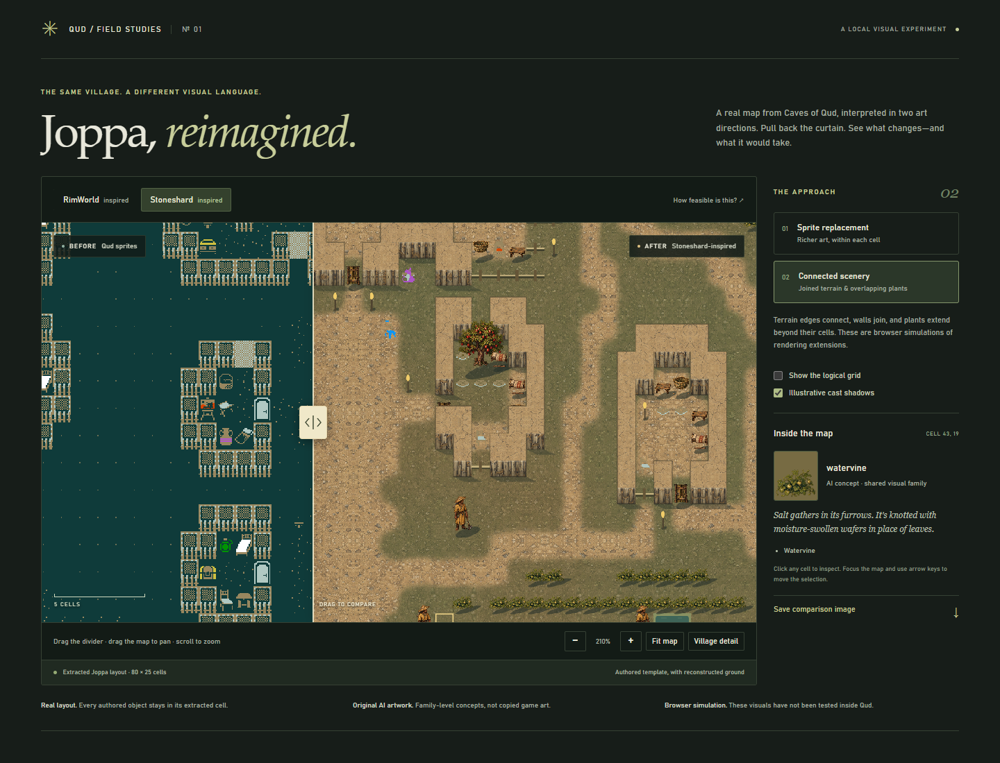
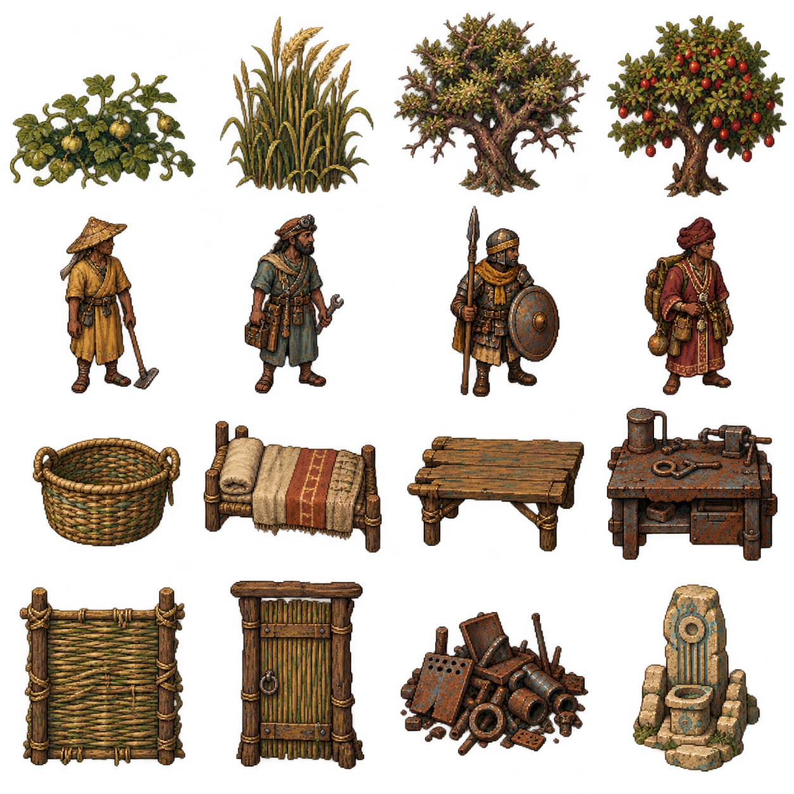

# Archived HTML visual study

These images predate the actual RimWorld-shader experiment. They are an HTML
rendering simulation using original AI-generated concept sprites, not engine-test
results. The current real readbacks are shown in [the README](../README.md).

The browser slider compares Qud's original presentation on the left with an
illustrative replacement on the right. Walls, roads and several NPCs need work,
and the two art directions are less distinct than intended.

## RimWorld-inspired concepts

## Stoneshard-inspired concepts

The target remains high contrast with Qud's colors, silhouettes and identity,
converting individual assets deliberately. These generic concept sheets are
exploration, not a finished or approved tileset.
